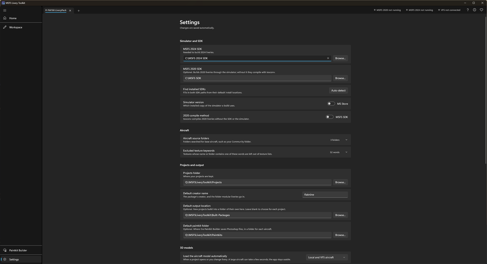
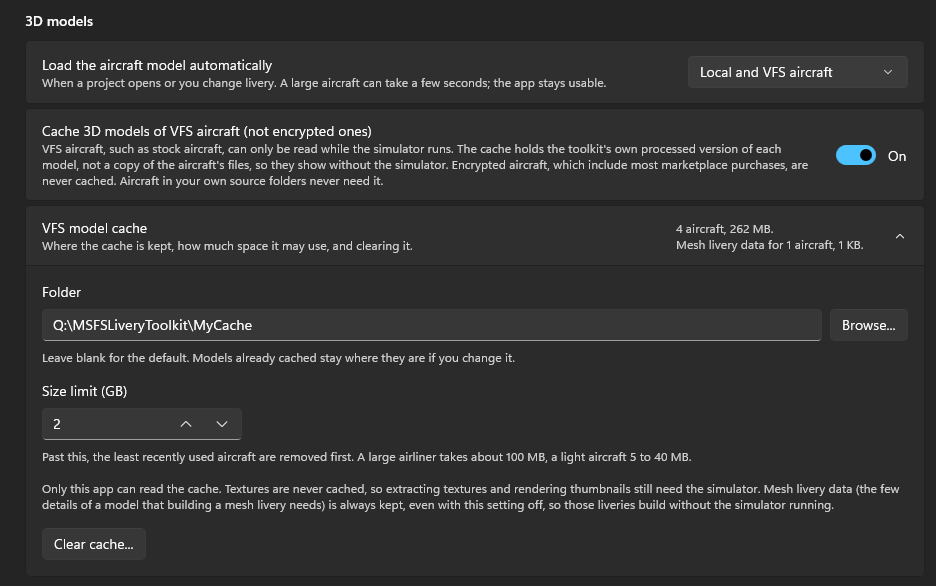
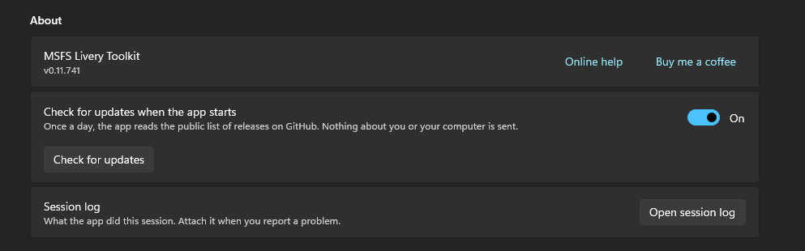

# Configuration

The **Settings** page holds the settings the toolkit needs to find your aircraft and drive the SDK. Changes are saved automatically.

## Simulator and SDK

- **MSFS 2024 SDK** and **MSFS 2020 SDK:** the app auto-detects the default install locations; set at least one, matching the aircraft you intend to build for. **Find installed SDKs** fills in both from their default locations.
- **Simulator version:** which installed copy of MSFS a build drives, **MS Store** or **Steam**. It controls the `-forcesteam` flag passed to the SDK build tool, and which copy the build screen's **Launch** action starts on a machine with both installed.
- **2020 compile method:** **MSFS SDK**, or **texconv**, a bundled encoder (Microsoft DirectXTex, MIT-licensed) that compiles MSFS 2020 liveries with no SDK or simulator installed at all. The SDK is used unless you choose texconv, which is chosen for you if no 2020 SDK is found.

{: .warning }
> **The Steam build path is untested.** I only own an MS Store copy of MSFS, so this option has never been verified against a real Steam install; only MS Store is confirmed working. If you hit a problem while using it, please [open an issue on GitHub](https://github.com/theflaknine/MSFS-Livery-Toolkit/issues/new) and attach your session log (Settings > About > **Open session log**).

## Aircraft

- **Aircraft source folders:** the folders scanned for base aircraft. Your MSFS Community folders are detected automatically, so there is no need to add them; **Detect Community folders** finds them again if needed. Add any other folder, such as an add-on linker location, with **Add folder...**.
- **Excluded texture keywords:** textures whose name or folder contains one of these words are left out of the texture list when you add a livery or add textures, to filter out textures livery artists rarely need, such as "tire" or "gauge". Edit the list as you need; **Restore defaults** puts it back.

## Projects and output

- **Projects folder:** where each project's workspace subfolder is created.
- **Default creator name:** pre-fills the manifest `creator` field and, for modular aircraft, the `liveries\<creator>` folder name. Editable per livery afterwards.
- **Default output location:** the parent folder pre-filled when you create a new project. Leave it blank to choose for each project.
- **Default paintkit folder:** the parent folder pre-filled on the [Paintkit Builder]({{ '/paintkit-builder.html' | relative_url }}) page. A folder named after the aircraft is created inside it for each build, and you can change the location per build.

## 3D models

**Load the aircraft model automatically** decides whether the [Workspace]({{ '/workspace.html' | relative_url }}) loads the aircraft into its viewport by itself when a project opens or you change livery:

- **Off**: select **Load aircraft model** yourself.
- **Local aircraft only**: aircraft on your own drives load straight away.
- **Local and VFS aircraft**: stock and Marketplace aircraft load too, if the VFS was connected when the project opened, or the VFS model cache below already holds the aircraft.

Loading reads every model file of the aircraft, which can take several seconds on a large one; the rest of the app stays usable meanwhile. An aircraft the simulator protects never loads.

### VFS model cache

Stock and Marketplace aircraft can only be read while the simulator runs. **Cache 3D models of VFS aircraft** keeps the toolkit's own processed copy of each model it loads, so those aircraft still show in 3D, and their mesh liveries still build, with the simulator closed. The app asks the first time you load a VFS aircraft's model, and this switch changes your answer. See [Working with the simulator closed]({{ '/workspace.html' | relative_url }}#working-with-the-simulator-closed).

- **Folder**: where the cache is kept. Leave it blank for the default, `%LOCALAPPDATA%\MsfsLiveryToolkit\ModelCache`.
- **Size limit (GB)**: past this, the least recently used aircraft are removed first. A large airliner takes about 100 MB, a light aircraft 5 to 40 MB.
- **Clear cache...** deletes everything the cache holds.

Textures are never cached, so extracting textures and rendering thumbnails for these aircraft still need the simulator. Encrypted aircraft are never cached. What the cache holds, and what it never holds, is set out in [Trust & safety]({{ '/trust-and-safety.html' | relative_url }}#the-vfs-model-cache).

## Textures

**Extract at full bit depth** extracts the rare 16-bit base textures as 16-bit PNGs, as the SDK recommends, instead of 8-bit. The files are larger. It is recommended to leave this option on.

## Sticker library

**Sticker library folder** is where [Texture painting]({{ '/texture-painting.html' | relative_url }}) keeps your sticker images. It is an ordinary folder, by default `Documents\MSFS Livery Toolkit\Stickers`, so you can add, rename and share images in Windows Explorer too. Select **Browse...** to move it. Images already in the old folder are not moved for you.

## Appearance

**Monochrome icons** shows the Workspace's icons in the text colour instead of coloured by type.

## Advanced

**MSFSLayoutGenerator** is used to regenerate `layout.json` on every build. A copy is **bundled with the app and used automatically**, so you don't need to download or set anything. Set a path here only if you want to use your own copy (for example a [newer release](https://github.com/HughesMDflyer4/MSFSLayoutGenerator/releases)).

## About

- **Check for updates when the app starts:** once a day, the app reads the public list of releases on GitHub and tells you when a newer version is out. Nothing about you or your computer is sent. Clear it to turn the check off; **Check for updates** checks whenever you select it, whatever the switch says. See [Updating]({{ '/getting-started.html' | relative_url }}#updating).
- **Session log:** **Open session log** opens the log of the current run. Attach it when you report a problem.

The **About** window (the **i** at the top right of the app) lists every bundled third-party component and its license, including the GPL-3 decompressor used only for the compressed-texture extraction case. The full license texts ship in `THIRD-PARTY-NOTICES.txt` and the `licenses` folder beside the launcher, and `LICENSE.txt` there holds the terms of use for the app itself. **Check app files** there compares the app's files with the list the release was built with.
