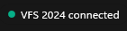
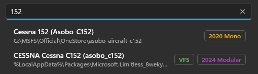
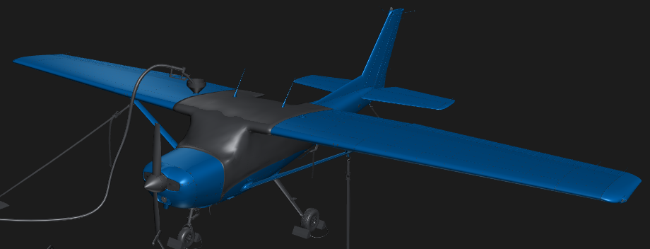
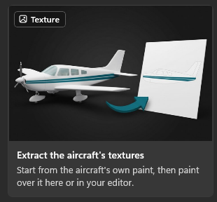
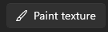
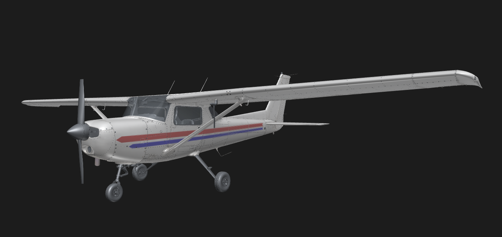

# Your first livery
{: .no_toc }

This page takes one livery from start to finish on the Cessna 152, which comes free with both MSFS 2020 and MSFS 2024: start a project, add a livery, paint it, compile it and fly it. The steps are written for MSFS 2024, and a note says where MSFS 2020 is different. Each step links to the full page on that subject when you want more.

1. TOC
{:toc}

---

## Before you start

- **Developer Mode on.** Turn it on in the simulator's **General** options.
- **The MSFS SDK installed.** Download it from Developer Mode: the **DevMode** menu, **SDK Updates**.
- **The app set up.** Open **Settings** and check the SDK path. See [Getting started]({{ '/getting-started.html' | relative_url }}#first-run-setup).

On MSFS 2024, stock aircraft are read through the simulator's Virtual File System (VFS), so the simulator runs for the first part of this walkthrough, is closed to compile, and runs again to fly.

{: .note }
> **MSFS 2020:** stock aircraft are ordinary files on your drive, so the simulator doesn't need to run until you fly. In **Settings**, select **Add MSFS 2020 aircraft** so the app finds them. You don't need the SDK or Developer Mode either: with **2020 compile method** set to **texconv** in **Settings**, the app compiles 2020 liveries on its own. It's set for you when no MSFS 2020 SDK is installed.

## 1. Connect the VFS

Start MSFS 2024. With Developer Mode on, select **Tools**, **Virtual File System**, **VFS Projector**, **Start**.

The **VFS** chip at the top right of the app shows when it's connected.

Leave the simulator running until step 6.

{: .note }
> **MSFS 2020:** skip this step.

## 2. Start a project

A project is one package for one aircraft. On the **Home** page, under **New project**:

1. Select **Discover aircraft**, then pick the Cessna 152 from the list. Search for "152" to find it quickly. On MSFS 2024 it has a green **VFS** badge.
2. Enter a **Project name**.
3. Check the **Output location**: the folder the compiled package is written to.
4. Select **Create project**.

The badge beside the aircraft shows its type: **2024 Modular** for the MSFS 2024 Cessna 152, **2020 Mono** for the MSFS 2020 one. The app handles the difference for you. See [Supported aircraft]({{ '/supported-aircraft.html' | relative_url }}).

The project opens in the [Workspace]({{ '/workspace.html' | relative_url }}) and goes straight into adding your first livery.

## 3. Add a livery

Adding a livery takes three steps, with the aircraft in 3D beside you.

1. **Details.** Enter a **Title**, the name the simulator shows for your livery, and an **ATC id / registration**.
2. **Textures.** Choose the textures you want to change. The paint is in the textures marked **ALB** (albedo, the colour). Select a part of the aircraft in the 3D view to add its texture.
3. **Fallback.** Optional. You can skip it.

Select **Add livery**.

Your livery changes only the textures you chose. Everything else comes from the aircraft itself. See [Creating liveries]({{ '/creating-liveries.html' | relative_url }}#adding-a-livery).

## 4. Start from the aircraft's own paint

The **Start your livery** dialog opens. Select **Extract the aircraft's textures**.

Each texture you chose gets a PNG of the aircraft's own paint, its **Base PNG**, which you paint over in the next step. To start from plain images instead, select **Start from blank**.

On MSFS 2024, extracting needs the simulator running with the VFS Projector on. When the app first loads the aircraft's 3D model, it asks whether to keep a copy. Select **Cache models**, and the aircraft still shows in the Workspace once the simulator is closed. See [Working with the simulator closed]({{ '/workspace.html' | relative_url }}#working-with-the-simulator-closed).

## 5. Paint

Paint in the app, in your own image editor, or both.

**In the app.** Select a texture in the tree, then **Paint texture** at the top of the Workspace. You paint straight onto the aircraft in 3D, on layers over the base PNG. Select **Done** to save and leave. See [Texture painting]({{ '/texture-painting.html' | relative_url }}).

**In your own editor.** Select the livery's **Textures** folder, then **Open image folder**. Edit the PNG files there and save them under the same names. If you work in a layered file such as a PSD, export the PNG from it each time; **Link a file...** on the texture remembers where that file is.

To paint on a template rather than the aircraft's own paint, make a paintkit for your editor with the [Paintkit Builder]({{ '/paintkit-builder.html' | relative_url }}), in the navigation pane.

## 6. Compile

Close the simulator first: the SDK starts it on its own to build your textures.

1. Select **Compile** at the top of the Workspace.

   

2. Select **Compile project**, then **Compile** to confirm.

The simulator opens and closes by itself while it builds. Don't close it while the build is running. When the build finishes, **Open folder** shows the package. See [Compiling]({{ '/compiling.html' | relative_url }}).

{: .note }
> **MSFS 2020 with texconv:** no simulator opens, and the build takes a few moments.

## 7. Fly it

1. Put the package folder in your Community folder, or add it with MSFS Addons Linker.
2. Start the simulator. **Launch MSFS 2024** on the Compile page does it for you.
3. Choose the Cessna 152, then your livery by its title.

Changed your artwork? Compile again, with the simulator closed.

{: .note }
> **MSFS 2020:** use your MSFS 2020 Community folder, and **Launch MSFS 2020**.

## Next steps

- [Registration numbers]({{ '/creating-liveries.html' | relative_url }}#registration-numbers): how the simulator draws your livery's registration.
- [Mesh decals]({{ '/mesh-decals.html' | relative_url }}): shapes and images built as geometry on the aircraft.
- [Choosing which configurations show your livery]({{ '/creating-liveries.html' | relative_url }}#choosing-which-configurations-show-your-livery), on aircraft with several.
- [Supported aircraft]({{ '/supported-aircraft.html' | relative_url }}): what works on each kind of aircraft.
