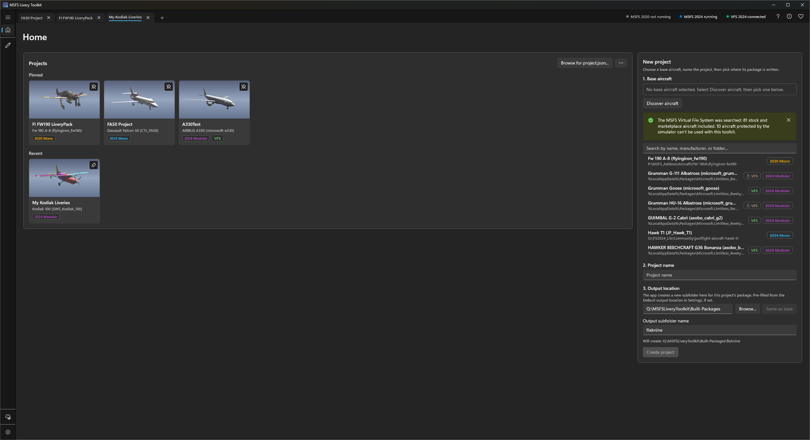
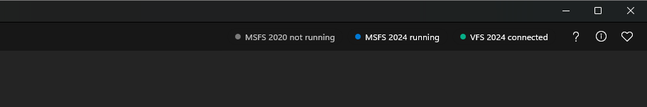
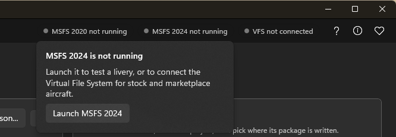
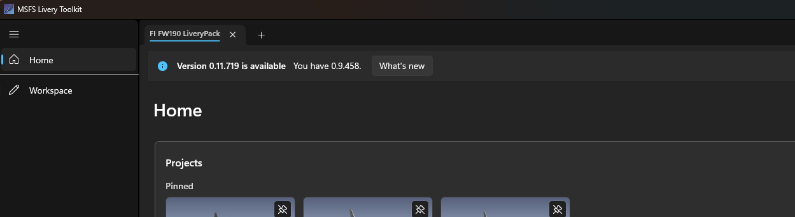
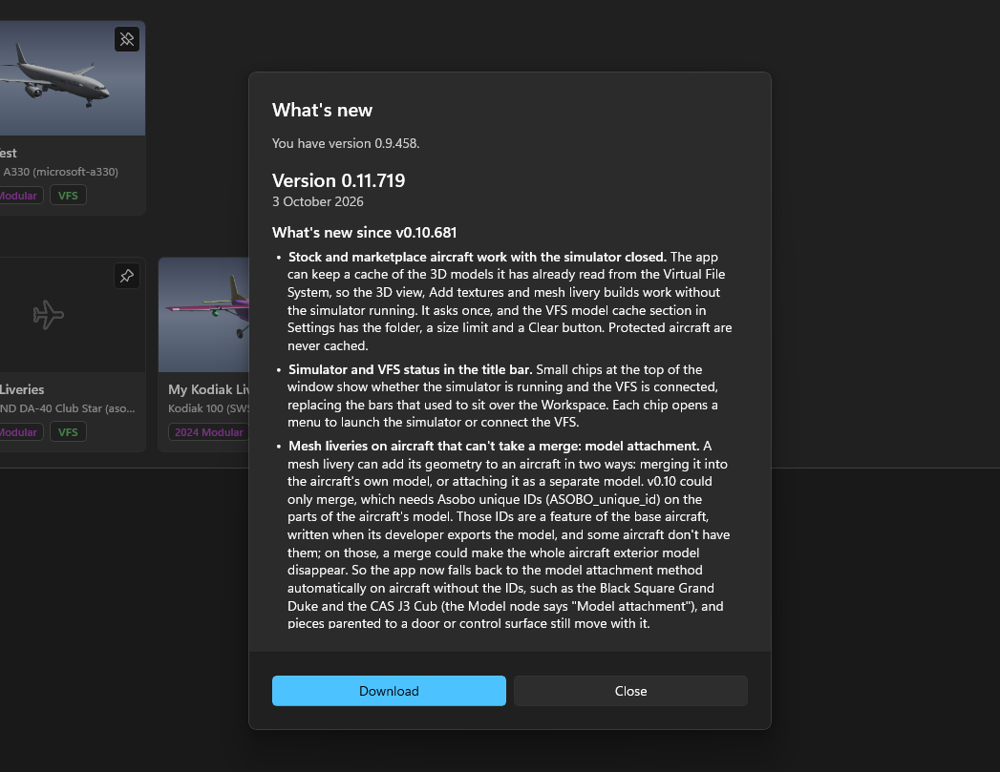

# Getting started
{: .no_toc }

1. TOC
{:toc}

---

## Download and installation

Grab the latest portable release using the button above. There is no installer: unzip the download, then double-click **MSFS Livery Toolkit** at the top of the extracted **MSFS Livery Toolkit** folder to start the app. Everything else the app needs lives in the `app` subfolder next to it; you don't need to open that folder or run anything inside it. You'll probably get a Windows warning about an unsigned app, so you'll need to click **More Info > Run Anyway** to proceed, if you are comfortable to do so. See **https://theflaknine.github.io/MSFS-Livery-Toolkit/trust-and-safety.html** for more details on unsigned applications.

## First-run setup

Before you can discover aircraft or compile anything, open the **Settings** page and set up:

- **Aircraft source folders:** the folders scanned for installed base aircraft. Use **Detect Community folders** to find them automatically, and / or **Add folder…** to point at a Community / add-on-linker location manually.
- **At least one MSFS SDK path:** (2020 or 2024). The app auto-detects the default install locations; confirm or correct them here.

If either is missing, the Home page shows a **"Let's get you set up"** banner with a shortcut to Settings, and *Discover aircraft* stays disabled until it's resolved.

## Creating a project

On the **Home** page:
1. (Optional) If you want to include stock or Marketplace aircraft you must first mount the MSFS Virtual File System (VFS). View MSFS SDK documentation [here](https://docs.flightsimulator.com/msfs2024/html/2_DevMode/Menus/Tools/The_Virtual_File_System.htm) for instructions, or open the VFS chip at the top of the window (see [Simulator and VFS status](#simulator-and-vfs-status)). Aircraft located in the VFS will display a green "VFS" badge at the next step. 
2. Click **Discover aircraft** to populate the base-aircraft list, then pick one. Search by title, manufacturer, or folder name. A colour-coded **profile badge** shows whether it's 2020 Mono, 2024 Mono, or 2024 Modular. *Note we are referring to non-modular aircraft as "monolithic", hence the label "mono".* **Encrypted aircraft have limited support.** Some stock and Marketplace aircraft are encrypted, partly protected by the simulator. Encrypted 2024 modular aircraft appear in the list with a padlock and can be used for liveries, without 3D previews or UV maps. Other encrypted aircraft are left out, and the Discover message says how many. See [Supported aircraft]({{ '/supported-aircraft.html' | relative_url }}) for exactly what works on each kind of aircraft.   
    
    
    
3. Name your project.
4. Confirm the **output location**. The app suggests a folder name following MSFS naming conventions (`<company>-aircraft-<name>-livery-<project>`), but it's fully editable, and a live preview shows the exact path that will be created. You can optionally choose to create the output folder as a sibling folder of the base aircraft folder.
5. Select **Create project**. This makes an empty project with no liveries yet.
6. The project opens in the [Workspace]({{ '/workspace.html' | relative_url }}) and goes straight into adding your first livery. See [Creating liveries]({{ '/creating-liveries.html' | relative_url }}).

The navigation pane down the left shows only icons by default. Its menu button at the top widens it to show their names, and it remembers which you prefer.

## Simulator and VFS status

The top right of the window always shows whether each simulator you have installed is running, and whether the Virtual File System (VFS) is connected:

Select a chip for more. A simulator's chip can launch it, and the VFS chip explains how to connect the VFS for stock and Marketplace aircraft.

The chips only watch; nothing starts or connects unless you ask. Close the simulator before you compile, because a build starts it itself.

## The two locations of a project

Every project lives in two places on disk:

- **Workspace:** holds the project save file and your loose, editable PNG artwork. Safe to move or rename; the app always finds the project relative to wherever the `project.json` is opened from.
- **Deployment target:** the final compiled package the simulator reads.

Both are shown when you select the project at the top of the Workspace tree, each with **Copy** and **Open** buttons. Right-click the project row to open them in Windows Explorer, along with the base aircraft's folder.

## Opening and pinning projects

The **Projects** panel on Home shows your projects as cards, each with a picture of its first livery, its base aircraft and its badges. Select a card to open the project.

- **Pinned:** projects you want to keep at hand. Use the pin on a card to pin or unpin it; a pinned project never drops off the list.
- **Recent:** an automatically maintained, capped history. The **...** button next to **Browse for project.json...** clears the unpinned recents, or everything including the pinned ones.

## Updating

When a new version is out, the app tells you. Once a day, when it starts, it reads the public list of releases on GitHub, and if there is a newer one a bar appears at the top of the window:

**What's new** shows the notes of every release since yours, newest first, so nothing is missed if you skipped a few. **Download** opens the release page in your browser. Closing the bar hides it until the next time you start the app.

To update:

1. Download the new zip.
2. Close the app, then **delete the old MSFS Livery Toolkit folder**, or unzip the new one somewhere else. Don't unzip a new version over an old one: files the new version no longer uses would be left behind in its `app` folder.
3. Unzip and start the new version as before.

Your settings and projects are not kept in the app's folder, so nothing is lost.

If files from two versions do get mixed, the app warns you when it starts. When the only problem is leftover files, **Clean up** moves them to the Recycle Bin. For anything else, it tells you to delete the folder and unzip again. You can also check at any time: **About** (the **i** at the top right) has **Check app files**, which compares every file with the list the release was built with.

The update check sends nothing about you or your computer. To turn it off, clear **Check for updates when the app starts** in [Settings]({{ '/configuration.html' | relative_url }}#about); **Check for updates** next to it still checks whenever you ask. See [Trust & safety]({{ '/trust-and-safety.html' | relative_url }}#does-it-phone-home).
