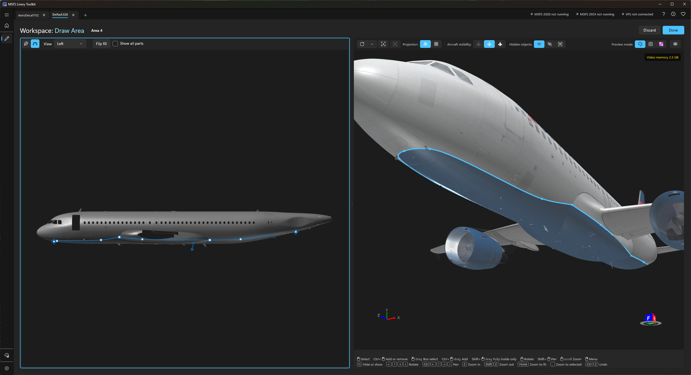
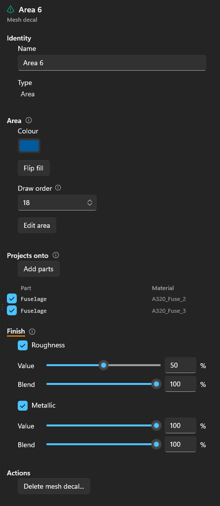
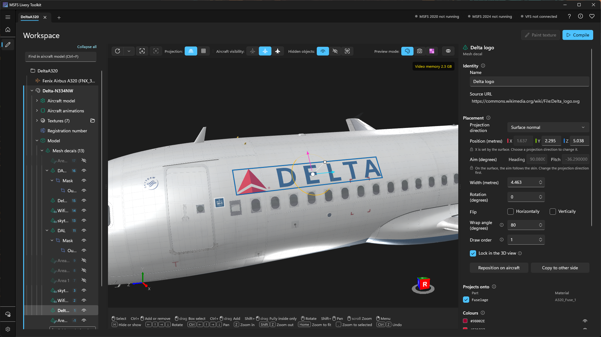
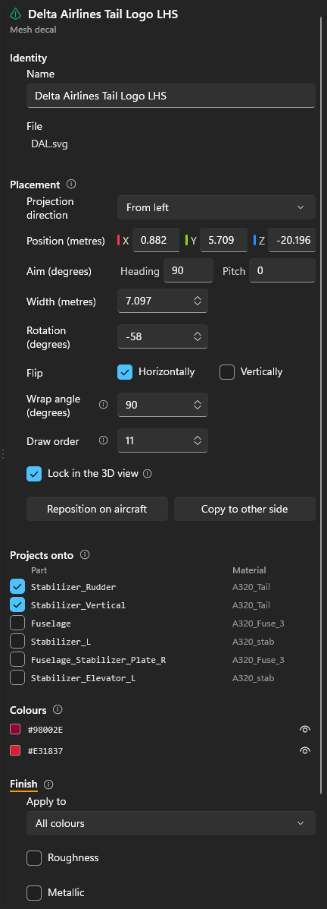
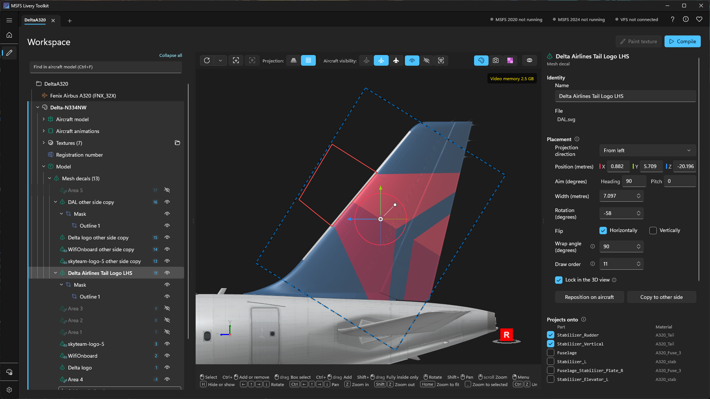

# Mesh decals
{: .no_toc }

A **mesh decal** is a logo, sign, placard or area of colour added to the aircraft as thin geometry just off its skin, instead of being painted into its textures. An SVG decal or an area stays sharp however close you get. A PNG decal is still an image, but it covers only its own small patch of the aircraft, so it can carry far more detail there than the aircraft's own texture. None of them needs a 3D modelling tool: you give the toolkit an SVG or a PNG, or draw an area, and the toolkit cuts it to the shape of the skin and builds it with your livery.

1. TOC
{:toc}

---

## Which aircraft

Mesh decals work on **MSFS 2024 aircraft**, both monolithic and modular, including stock aircraft read through the Virtual File System. They are not available for MSFS 2020 aircraft, for aircraft the simulator protects (Marketplace purchases usually are), or for aircraft whose model has no node ids, the identifiers the simulator merges by (see [Mesh liveries]({{ '/mesh-liveries.html' | relative_url }}#when-the-toolkit-falls-back-to-attaching)). On those, the **Mesh decals** row is greyed out and says why. See [Supported aircraft]({{ '/supported-aircraft.html' | relative_url }}).

---

## SVG, PNG or area

- **An SVG** becomes one solid colour per shape, with no texture, so its edges stay clean at any size. Solid colours and linear gradients are supported. This suits logos and lettering.
- **A PNG** becomes one textured rectangle, much sharper than the aircraft's own texture, for small signs and placards. The image can be up to 4096 pixels on each side; the toolkit never resizes it.
- **An area** is one colour inside a curve you draw on the aircraft, such as a belly colour. Its edge is geometry, so it stays sharp however close you get, and it runs cleanly across texture seams. See [Drawing an area](#drawing-an-area).

{: .note }
> Convert any text to paths in your vector editor before you export the SVG, or the text can't be shown.

---

## Adding a mesh decal

1. Load the livery's aircraft in the viewport.
2. In the [Workspace]({{ '/workspace.html' | relative_url }}) tree, open the livery's **Model** node, then the **Mesh decals** folder, and select **Add mesh decal...** (or right-click the folder), then **From image...**.
3. In **Link or file**, paste a link to an SVG file or a Wikimedia Commons file page, or select **Browse...** to pick an SVG or PNG file. A link must be to an SVG; save a PNG and add the file instead. Give the decal a **Name**.
4. Click the aircraft where the decal should go. **Esc** cancels.

The toolkit keeps its own copy of the file in the livery's workspace. A PNG also stays linked to the file you picked, so when you change the image, the decal updates (**Reload image** on its properties checks again).

### What an SVG can't use

A mesh decal is flat shapes, so some SVG features can't be shown:

- **A radial, repeating or partly transparent gradient** stops the SVG being added. Use linear gradients instead.
- **Other features**, such as an SVG's own masks, are ignored. The dialog warns you first and lets you **Add anyway**, and the decal's **Differences from the SVG file** section lists what was ignored. To trim a decal, give it a [mask](#masks) instead.

---

## Drawing an area

1. In the **Mesh decals** folder, select **Add mesh decal...**, then **Draw area**. The Workspace switches to **Draw Area**: a flat drawing view on the left, with a blue edge, and the aircraft in 3D on the right. You place points only in the drawing view; the 3D view shows the result and turns as usual.
2. Choose a **View**: **Left**, **Right**, **Top**, **Bottom**, **Front** or **Back**.
3. With the **Pen** (**P**), click the aircraft to add points. The fill updates as you go.
4. Select **Done** at the top right of the page, or press **Esc**. **Discard** leaves without keeping your changes, and asks first if anything changed.

An area is mirrored: you draw one side, and the other side follows. To change an area later, select **Edit area** on its row's menu or in its properties.

In the drawing view, the wheel zooms, a right or middle drag pans, and **Ctrl** with a middle drag zooms too.

### The centre line

- In **Top**, **Bottom**, **Front** and **Back**, the centre line is drawn, and a point close to it snaps onto it and shows a diamond. Hold **Alt** while dragging to keep a point off it.
- With **both** ends of the curve on the centre line, the two sides join into one area across the aircraft, such as a belly. With **neither**, each side is a patch of its own. With only one end on it, the area isn't finished, and **Done** says why.
- In **Left** and **Right**, a point on the centre line slides along where the skin meets it, so you can take it round the nose or over the roof. It can't leave the centre line there: drag it sideways in **Top**, **Bottom**, **Front** or **Back** for that.

### Editing points

- **Edit points** (**A**) drags points and never adds them. With the **Pen**, clicking the curve inserts a point.
- **Shift** lines a new point up with the one before it, and keeps a dragged point on its row or column.
- **Double-click** a point, or **Alt+click** it, to make it a sharp corner or smooth again.
- Right-click a point for **Corner** and **Delete**. For a mirrored point, **Unlink** lets each side move on its own, **Link again** puts them back together, and **One side only** keeps it on one side. **Ctrl+click** adds a point on the side you click only.
- **Delete** removes the selected point, and **Ctrl+Z** undoes the last change to the points.
- A point drawn grey and dashed faces away from this view. Hover over it to see which view to edit it from.

### What it covers

- **Flip fill** fills the other side of the line. A curve splits the parts it is drawn on in two, and an arrow in the drawing view points into the side that is filled.
- **Projects onto** lists the parts the area covers: the parts your points land on, and their twins on the other side. In the area's properties, select **Add parts**, then click parts on the aircraft to add or remove them. **Show all parts** in the drawing view shows the parts the area isn't on as well.
- The area's properties hold its **Colour**, which shares Texture Paint's recent colours and favourites, its **Draw order**, and its **Finish**, as for any mesh decal (see below).

{: .note }
> Areas are designed round a single fuselage. On a twin-boom aircraft or a flying wing, an area may come out partly drawn, or not at all, so check it in the 3D view before compiling.

---

## Placing and moving

With the decal selected, in the tree or by clicking it on the aircraft:

- **Drag** it on the aircraft to move it.
- **The handles**: drag an **arrow** to move it, a **ring** to turn it, or the **scale handle** to size it. Hold **Ctrl** for whole centimetres, or 5 degree steps when turning.
- **Ctrl+wheel**, or **[** and **]**, changes its width.
- **Shift+wheel** turns it 15 degrees, **Ctrl+Shift+wheel** 1 degree. At 0 degrees it is level, whatever the camera angle.
- **Right-click** it in the 3D view for the same menu as its row.
- **Delete** removes it, after asking.
- **Ctrl+Z** undoes the last change while a decal's row is selected.

It shows as a see-through flat plate while it moves, then as the finished decal, cut to the skin, when you let go.

The **Placement** section has the exact values: **Width (metres)**, **Rotation (degrees)**, **Flip** horizontally and vertically, and for a PNG, **Sharpness** in pixels per metre. **Reposition on aircraft** moves the decal to the next place you click.

- **Wrap angle (degrees)**: how far round a curve the decal reaches. Set about 90 to reach round a leading edge, such as a fin's from the side. Near the edge the artwork stretches, which a plain colour hides but lettering doesn't.
- **Lock in the 3D view** stops a drag, the handles or the wheel moving the decal by accident. The values on its properties still work.

### Off the surface

Normally a decal sits on the skin and faces it. Change **Projection direction** from **Surface normal** to a side, such as **From left**, and it comes off the surface: it is then projected from where it is, the way it aims, onto the parts in **Projects onto** in front of it. **Position (metres)** and **Aim (degrees)** set exactly where it is and which way it points. **Snap to surface** puts it back on the skin.

### Copies

- **Copy to other side**, on the decal's menu or in **Placement**, adds a separate decal in the mirror position on the other side of the aircraft, mask included. The artwork isn't flipped, so lettering still reads the right way round.
- **Duplicate** makes a copy in the same place.

{: .tip }
> Keep decals to a sensible size. A decal wider than the curve of the fuselage can take is stretched where the surface turns away, and the properties warn you when more than 5% of it is stretched.

---

## Which parts it lands on

**Projects onto** lists the parts the decal reaches. Only the selected parts take the decal; any other part, such as an aerial in the way, is ignored and the decal continues on the surface beneath it. The part you click when placing is selected for you. Select more, for example to carry a logo across a door.

A decal that crosses a door or a control surface is cut into pieces, and each piece moves with its own part, so the logo opens with the door.

On a modular aircraft, some parts can't take a livery's geometry at all. They are dimmed in the list, and that piece of the decal won't appear in the simulator.

---

## Masks

A mask trims an SVG or PNG decal to outlines you draw on it in the 3D view, for example to stop a logo at the edge of the tail.

1. Select **Add mask** on the decal's menu or in its properties. A **Mask** row appears under the decal, with an empty outline, and the **Pen** is ready.
2. Click the decal to add points, or click an edge to insert one. Right-click a point to remove it. **Enter** or **Esc** finishes. An outline needs at least 3 points before it trims anything.
3. **Add outline** on the Mask row adds another outline.

Each outline keeps what is inside it. Select **Cut away the inside** on an outline to cut its inside away instead. To change an outline later, select **Edit points** on it.

The mask moves, turns and resizes with the decal, and each outline and the mask itself have an **Eye** to switch them off. **Delete mask** makes the decal whole again.

---

## Colours, finish and draw order

- **Colours** (SVG only): exclude a colour to remove it from the decal, such as a panel behind a logo. The rest of the logo keeps its size and position.
- **Finish**: select **Roughness** or **Metallic** to give the decal its own finish; cleared, it keeps the finish of the surface underneath. **Blend** sets how much of the value replaces the surface's own. With several colours, **Apply to** picks one colour or **All colours**. The viewport shows an approximation of the finish.
- **Draw order**: where decals overlap, the higher draw order is on top, from -999 to 999. The **Mesh decals** folder lists every decal with its draw order, and right-clicking a decal offers **Move up**, **Move down**, **Move to top** and **Move to bottom**. The viewport layers every decal by draw order, as the simulator does: your mesh decals, your own model's decals and the aircraft's. The **i** beside **Draw order** lists the decals this one overlaps, under **Draws over**, **Same draw order** and **Draws under**.

The **Eye** on a decal's row hides it in the viewport and leaves it out of the build.

---

## Stock aircraft

The simulator can't run while a livery compiles, but a stock aircraft can only be read from the Virtual File System while it runs. So the toolkit cuts its mesh decals against a saved copy of the aircraft's model.

The **Mesh decals** folder's **Compile** section shows the **Status**. The copy is saved while the livery is open with the simulator's VFS Projector on, and saved again after the simulator updates the aircraft. Until it says **Ready**, open the livery once with the VFS Projector on. **Clear cache...** in [Settings]({{ '/configuration.html' | relative_url }}#vfs-model-cache) removes it.

---

## Compiling

Compile as usual. Every visible mesh decal of the livery is built into one model, which the simulator merges with the aircraft, the same way as a [mesh livery's own model]({{ '/mesh-liveries.html' | relative_url }}). A livery can have both your own model and mesh decals.

Check the result in the simulator, and open the doors to confirm a decal across one moves with it.
