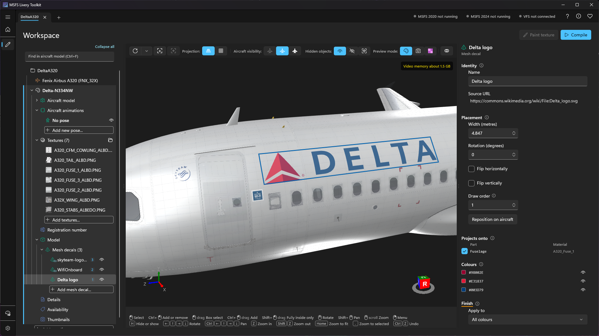
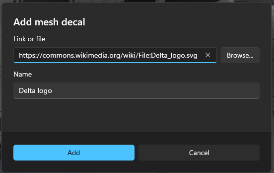
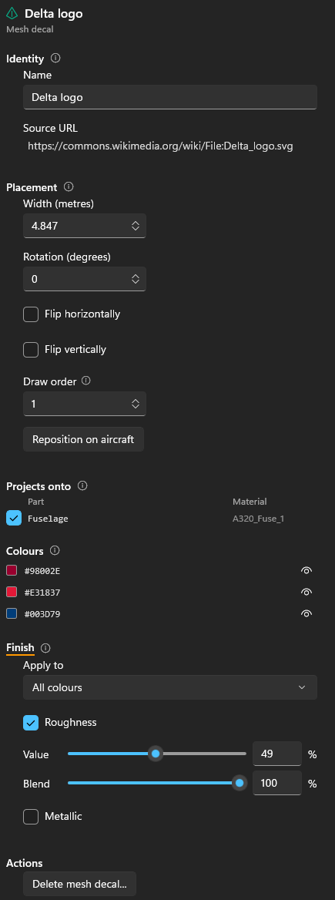

# Mesh decals
{: .no_toc }

A **mesh decal** is a logo, sign or placard added to the aircraft as thin geometry just off its skin, instead of being painted into its textures. An SVG decal stays sharp however close you get. A PNG decal is still an image, but it covers only its own small patch of the aircraft, so it can carry far more detail there than the aircraft's own texture. Neither needs a 3D modelling tool: you give the toolkit an SVG or a PNG, place it on the aircraft in the viewport, and the toolkit cuts it to the shape of the skin and builds it with your livery.

1. TOC
{:toc}

---

## Which aircraft

Mesh decals work on **MSFS 2024 aircraft**, both monolithic and modular, including stock aircraft read through the Virtual File System. They are not available for MSFS 2020 aircraft, for aircraft the simulator protects (Marketplace purchases usually are), or for aircraft whose model has no node ids, the identifiers the simulator merges by (see [Mesh liveries]({{ '/mesh-liveries.html' | relative_url }}#when-the-toolkit-falls-back-to-attaching)). On those, the **Mesh decals** row is greyed out and says why. See [Supported aircraft]({{ '/supported-aircraft.html' | relative_url }}).

---

## SVG or PNG

- **An SVG** becomes one solid colour per shape, with no texture, so its edges stay clean at any size. Solid colours and linear gradients are supported. This suits logos and lettering.
- **A PNG** becomes one textured rectangle, much sharper than the aircraft's own texture, for small signs and placards. The image can be up to 4096 pixels on each side; the toolkit never resizes it.

{: .note }
> Convert any text to paths in your vector editor before you export the SVG, or the text can't be shown.

---

## Adding a mesh decal

1. Load the livery's aircraft in the viewport.
2. In the [Workspace]({{ '/workspace.html' | relative_url }}) tree, open the livery's **Model** node, then the **Mesh decals** folder, and select **Add mesh decal...** (or right-click the folder).
3. In **Link or file**, paste a link to an SVG file or a Wikimedia Commons file page, or select **Browse...** to pick an SVG or PNG file. A link must be to an SVG; save a PNG and add the file instead. Give the decal a **Name**.
4. Click the aircraft where the decal should go. **Esc** cancels.

The toolkit keeps its own copy of the file in the livery's workspace. A PNG also stays linked to the file you picked, so when you change the image, the decal updates (**Reload image** on its properties checks again).

### What an SVG can't use

A mesh decal is flat shapes, so some SVG features can't be shown:

- **A radial, repeating or partly transparent gradient** stops the SVG being added. Use linear gradients instead.
- **Other features**, such as masks, are ignored. The dialog warns you first and lets you **Add anyway**, and the decal's **Differences from the SVG file** section lists what was ignored.

---

## Placing and moving

With the decal's row selected:

- **Drag** it on the aircraft to move it.
- **Ctrl+wheel**, or **[** and **]**, changes its width.
- **Shift+wheel** turns it 15 degrees, **Ctrl+Shift+wheel** 1 degree. At 0 degrees it is level, whatever the camera angle.
- **Ctrl+Z** undoes the last change while a decal's row is selected.

It shows as a see-through flat plate while it moves, then as the finished decal, cut to the skin, when you let go.

The **Placement** section has the exact values: **Width (metres)**, **Rotation (degrees)**, **Flip horizontally** and **Flip vertically**, and for a PNG, **Sharpness** in pixels per metre. **Reposition on aircraft** moves the decal to the next place you click.

Each side of the aircraft is a separate decal: add one for each side.

{: .tip }
> Keep decals to a sensible size. A decal wider than the curve of the fuselage can take is stretched where the surface turns away, and the properties warn you when more than 5% of it is stretched.

---

## Which parts it lands on

**Projects onto** lists the parts the decal reaches. Only the selected parts take the decal; any other part, such as an aerial in the way, is ignored and the decal continues on the surface beneath it. The part you click when placing is selected for you. Select more, for example to carry a logo across a door.

A decal that crosses a door or a control surface is cut into pieces, and each piece moves with its own part, so the logo opens with the door.

On a modular aircraft, some parts can't take a livery's geometry at all. They are dimmed in the list, and that piece of the decal won't appear in the simulator.

---

## Colours, finish and draw order

- **Colours** (SVG only): exclude a colour to remove it from the decal, such as a panel behind a logo. The rest of the logo keeps its size and position.
- **Finish**: select **Roughness** or **Metallic** to give the decal its own finish; cleared, it keeps the finish of the surface underneath. **Blend** sets how much of the value replaces the surface's own. With several colours, **Apply to** picks one colour or **All colours**. The viewport shows an approximation of the finish.
- **Draw order**: where decals overlap, the higher draw order is on top, from -999 to 999. The **Mesh decals** folder lists every decal with its draw order, and right-clicking a decal offers **Move up**, **Move down**, **Move to top** and **Move to bottom**.

The **Eye** on a decal's row hides it in the viewport and leaves it out of the build.

---

## Stock aircraft

The simulator can't run while a livery compiles, but a stock aircraft can only be read from the Virtual File System while it runs. So the toolkit cuts its mesh decals against a saved copy of the aircraft's model.

The **Mesh decals** folder's **Compile** section shows the **Status**. The copy is saved while the livery is open with the simulator's VFS Projector on, and saved again after the simulator updates the aircraft. Until it says **Ready**, open the livery once with the VFS Projector on. **Clear cache...** in [Settings]({{ '/configuration.html' | relative_url }}#vfs-model-cache) removes it.

---

## Compiling

Compile as usual. Every visible mesh decal of the livery is built into one model, which the simulator merges with the aircraft, the same way as a [mesh livery's own model]({{ '/mesh-liveries.html' | relative_url }}). A livery can have both your own model and mesh decals.

Check the result in the simulator, and open the doors to confirm a decal across one moves with it.
