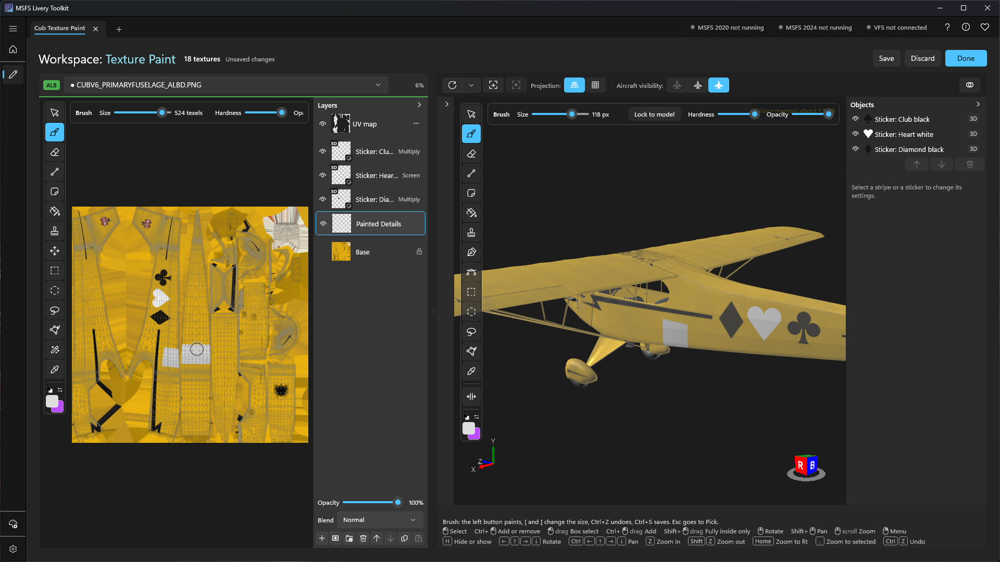
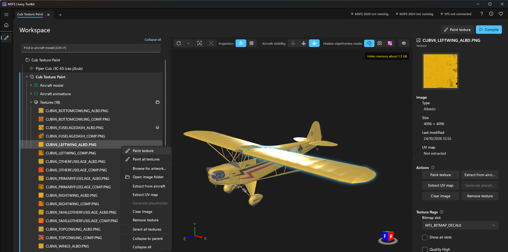
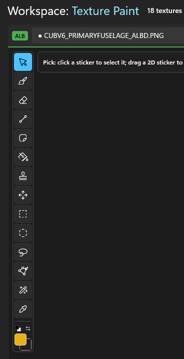
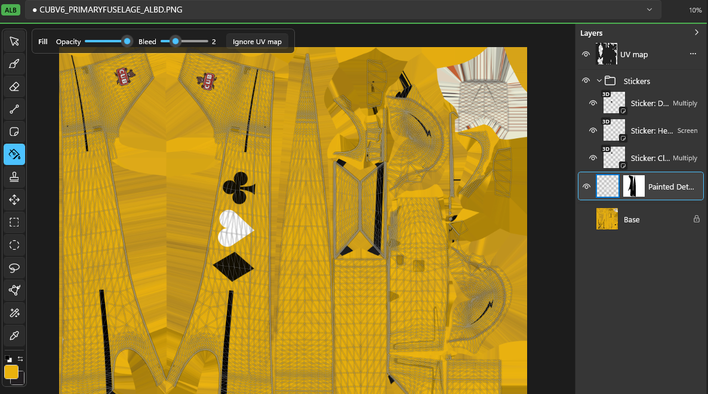
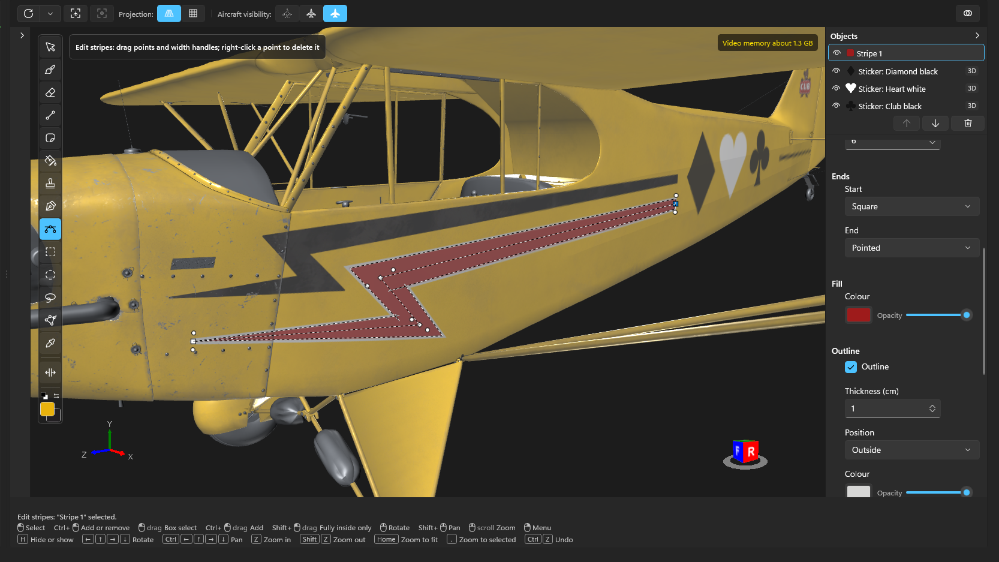
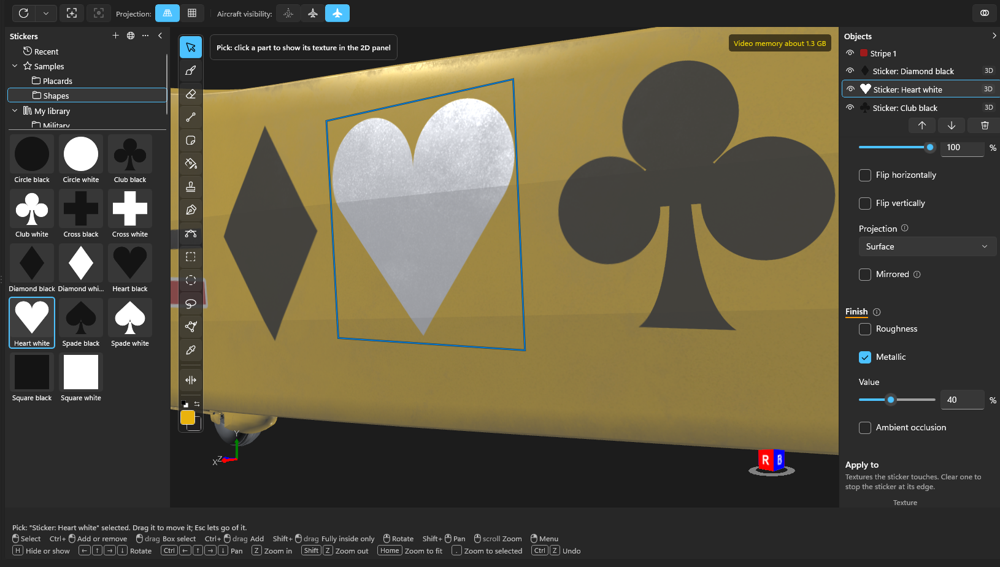

# Texture painting
{: .no_toc }

Texture Paint lets you paint your livery's textures inside the toolkit, on the flat texture or straight onto the aircraft in 3D. You get layers, masks, groups, stripes drawn as curves, stickers, a fill, a clone stamp and selections, and your original images are never changed: the paint is kept as layers on top of them, and the compile uses the result.

1. TOC
{:toc}

---

## Entering and leaving

Select a texture in the [Workspace]({{ '/workspace.html' | relative_url }}) tree and choose **Paint texture**, either at the top of the page beside Compile or in the texture's Actions. Right-clicking a texture, or a part of the aircraft, offers it too, along with **Paint all textures** to open every texture of the livery in one session.

The Workspace changes to Texture Paint:

- The tree and the properties panel fold away. The **2D panel** takes their place on the left, and the **aircraft** stays in 3D on the right. You can paint in either one, and both show every stroke as you make it.
- The page header reads **Workspace: Texture Paint**, with how many textures are open, whether there are unsaved changes, and **Save**, **Discard** and **Done**. The box above the 2D panel names the texture you are painting and switches to another.
- **Compile**, switching livery and closing the project are locked until you leave. If you try, the app asks whether to save.

**Ctrl+S** saves and stays in the mode. **Done** saves and leaves. **Discard** leaves and throws away everything since your last save. **Esc** steps back one level at a time: it clears a selection first, then offers to leave.

Some textures can't be painted yet. The app tells you why and, where it can, offers the fix:

- **The texture isn't in your livery.** Choose Add to put it in.
- **It has no image yet.** Choose Generate placeholder or Extract from aircraft first.
- **The aircraft is protected by the simulator.** Painting isn't available for protected aircraft.

---

## Where your paint is kept

Painting never changes your original image. The app keeps your paint separate and combines the two when it needs the finished texture.

- **Your original image.** The texture's PNG stays exactly as it was. It opens in Texture Paint as a locked **Base** layer, and everything you paint goes on layers above it.
- **The paint file.** Layers, masks and groups are stored in `Paint\<texture name>.ltpaint`, inside the livery's workspace folder. It holds your paint only, not a copy of the base.
- **The combined texture.** Each save also writes the base and your paint together as one image, `Paint\baked\<texture name>.PNG`, with the same name as your original. The 3D view, the thumbnails and the compile use this one, so your paint reaches the compiled livery while the original stays as it is. It is 8-bit, even when the original is 16-bit.
- **Backups.** The first time you save in a session, the previous paint file is copied to `Paint\backups`, and the last two are kept. The combined image is rebuilt from the other two, so it needs no backup.

The paint file belongs to the toolkit. To keep painting in Photoshop or another editor instead, link the texture to that file as described in [Creating liveries]({{ '/creating-liveries.html' | relative_url }}#linking-to-artwork-made-in-another-program).

---

## The two views

Each view has a toolbar of tools down its left edge, and an options strip above it for the selected tool. The colour pair sits at the bottom of the toolbar: the **foreground** colour is what paints, the **background** colour is for the eraser's reveal and fills. **X** swaps them and **D** resets them to black and white. Select a swatch to choose a colour, and save colours you reuse as favourites.

**In the 2D panel**: the wheel zooms about the pointer, a middle-button drag pans, **Home** fits the texture and **1** shows it at 100%. A guide of the texture's UV layout can be turned on over the image. It is never painted, saved or compiled.

**In 3D**: the view moves as in the [Workspace]({{ '/workspace.html' | relative_url }}#mouse-and-keyboard). The brush paints onto whatever the pointer is over, on every texture that part uses, so one stroke can cross onto a neighbouring texture.

Three switches on the 3D toolbar shape how a stroke lands:

- **Mirror (Y)** also paints the mirror image on the other side of the aircraft's centreline.
- **Paint through** paints the surfaces behind the one you can see as well. It is slower, so leave it off unless you need it.
- **Brush size** can be locked to the screen, so the brush looks the same size at any zoom, or to the model, so it is a real size on the aircraft in millimetres.

---

## Tools

The same key selects the same tool in both views. Hover a tool for its name, key and what its modifiers do.

| Tool | Key | What it does |
|---|---|---|
| Pick | Esc | In 3D, selects a part and shows its texture in the 2D panel, selects a stripe or a sticker. |
| Brush | B | Soft or hard, with size, hardness, opacity and the foreground colour. Hold **Shift** to keep a stroke level or straight up. |
| Eraser | E | Takes paint away from the selected layer. |
| Line | U | Drag a straight line, painted when you let go. **Shift** locks it level or vertical, **Esc** cancels it. |
| Fill | G | Click a part of the texture (a UV island) to fill it with the foreground colour. With no island under the pointer, it fills the selection, or the whole image. **Shift+Backspace** fills the selection from either view. |
| Clone stamp | S | **Alt+click** sets the source, then paint to copy from it. Works across layers and, in 3D, across textures. |
| Eyedropper | I | Click takes the colour under the pointer as the foreground, **Alt+click** as the background. |
| Sticker | K | Places an image from the sticker library. See [Stickers](#stickers). |
| Move | V | In 2D, moves the selected layer. The arrow keys nudge it, **Shift** by 10 pixels. |
| Pen | P | In 3D, draws a stripe as a curve on the aircraft. See [Stripes](#stripes). |
| Edit stripes | A | In 3D, selects and reshapes stripes you drew. |

---

## Selections

Paint only lands inside a selection. Select tools in either view:

| Tool | Key |
|---|---|
| Rectangle | M |
| Ellipse (**Shift** for a circle) | Shift+M |
| Lasso (hold and draw) | L |
| Polygon lasso (click each corner, double-click or **Enter** to close) | Shift+L |
| Magic wand (2D only) | W |

In 3D a selection is a shape on the screen, and only the surface inside it takes paint. **Ctrl+D** clears it.

---

## Layers, masks and groups

The **Layers strip** is the column on the right of the 2D panel. Below the list are the selected layer's **Opacity** and **Blend** mode, then buttons to add, mask, group, delete, move, copy and paste.

- **Layers.** Add, delete, show and hide them, and give each its own opacity and blend mode, such as Normal, Multiply or Screen. Copy a layer's pixels with **Ctrl+C** and paste an image as a new layer with **Ctrl+V**. **Drag** a row to reorder it, or the up and down buttons.
- **Masks.** Add a black and white mask to a layer to hide part of it without erasing anything. Paint white to show and black to hide. **Alt+click** the mask button to start with the layer hidden. **Alt+click** a mask thumbnail to see and paint the mask on its own, and **Ctrl+click** it to turn the mask into a selection (**Shift** adds, **Alt** subtracts).
- **Groups.** Put layers in a group to move, hide or mask them together. Select layers and press **Ctrl+G**, or drag them into a group. A mask on a group applies to everything inside it.
- **UV map.** The first row of the strip is the texture's UV layout, shown as a guide.
- **Stripes and stickers on layers.** A sticker you place in 3D gets its own layer, marked 3D, and the stickers collect in a **Stickers** group. A stripe is an object in the **Objects strip** beside the 3D view, which lists every stripe and sticker with buttons to move one up or down or delete it.

Every stroke, move and layer change is one **Ctrl+Z** step.

---

## Stripes

The **Pen** draws a stripe straight onto the aircraft as a curve, which is how cheatlines and tail stripes are normally painted. A stripe stays editable, and it is drawn across every texture it crosses.

1. Choose the Pen and click points along the aircraft. **Alt+click** makes a sharp corner. **Shift** keeps a point level or straight up from the last.
2. Press **Enter**, double-click, or click the first point to finish.
3. Switch to **Edit stripes** to drag points, change the width at any point so the stripe tapers along its length, click the curve to add a point, and **Alt+click** a point to make it sharp or smooth again.

The stripe's properties set its fill colour and opacity, an optional outline (thickness in centimetres, inside or outside the stripe, with its own colour) and its two ends, **Start** and **End**: **Square**, **Triangular**, **Pointed** (a true taper) or **Forked** (a V notch). New stripes start with the ends of the last one. With **Mirror** on, a new stripe starts mirrored.

**Apply to** lists the textures a stripe paints, and **Finish** also writes ambient occlusion, roughness and metalness values into the aircraft's composite textures, under the stripe's colour. Finish only reaches composite textures that are already in your livery, so add one from the Textures folder first.

---

## Stickers

Stickers place a logo, badge or lettering image on the aircraft in 3D, or on the flat texture in 2D.

The **sticker library** is a pane at the left edge of the viewport. A folder tree lists **Recent**, **Samples** (plain shapes and placards that come with the app) and **My library**, with the images of the selected folder below. The buttons at the top add a folder or images, add from a link, and open more options. The app ships no national markings or insignia.

- **Add images** with **Add images...**, **Paste image**, or **Add from URL...**, which takes a link to an image or an SVG and a name. A Wikimedia file page link works too.
- **Place** one by choosing it and pressing **K**, or by dragging its tile onto the aircraft or the texture. **Ctrl+wheel** sizes it before you place it, **Shift+wheel** turns it.
- **Edit** a placed sticker from the Objects strip: move, resize, turn, flip, mirror and delete it, and choose its projection. It follows its part if the model changes.
- **Finish** writes **Roughness**, **Metallic** or **Ambient occlusion** values under the sticker into the aircraft's composite textures, as it does for stripes. **Apply to** lists the textures the sticker touches, and clearing one stops the sticker at its edge.

By default the library is the folder `Documents\MSFS Livery Toolkit\Stickers`. It is an ordinary folder, so you can add, rename and share images in Explorer. Change its location in [Settings]({{ '/configuration.html' | relative_url }}#sticker-library). Only images you add are stored there; Add from URL is the one place Texture Paint uses the network, and only when you ask. See [Trust & safety]({{ '/trust-and-safety.html' | relative_url }}#does-it-phone-home).

---

## Composite textures

A composite texture packs ambient occlusion, roughness and metalness into one image, one per colour channel. In Texture Paint you paint them as three separate grey images instead.

- Use the **channel switch** above the 2D panel to choose AO, Roughness or Metalness. White is full, black is none, and the colour pair becomes a pair of greys.
- Turn on **Preview** to show the channel in grey on the aircraft, unlit.
- **Extract from aircraft** per channel pulls the aircraft's own values in as a new layer to work from.
- Only composites already added to your livery can be painted.

Painting an albedo texture brings its composite along when it belongs to the same material, and the other way round, so a stroke on the colour also lands on the matching roughness.

---

## Tips

- Save often with **Ctrl+S**. Every save keeps a backup.
- Work from a selection or a mask when you need a clean edge. They are quicker to correct than a stroke.
- Turn on **Paint through** only when you mean to. On a big texture it is much slower than painting what you can see.
- When you are happy, leave with **Done**, then [compile]({{ '/compiling.html' | relative_url }}) as usual. The compile uses the combined texture, so your original PNG is left untouched.

## What isn't there yet

- Painting isn't available for aircraft the simulator protects.
- One brush stroke doesn't paint albedo and composite channels together. Switch channels to paint each.
- No layer styles (such as colour overlay), guides or rulers, and you can't select several layers at once.
- Moving a linked layer up or down in a document with groups doesn't restack it in the aircraft's other textures.
