# Texture painting
{: .no_toc }

Texture Paint lets you paint your livery's textures inside the toolkit, on the flat texture or straight onto the aircraft in 3D. You get layers, masks and groups, a brush, line, fill and gradient, a clone stamp, selections, stripes drawn as curves, stickers and text. Your original images are never changed: the paint is kept as layers on top of them, and the compile uses the result.

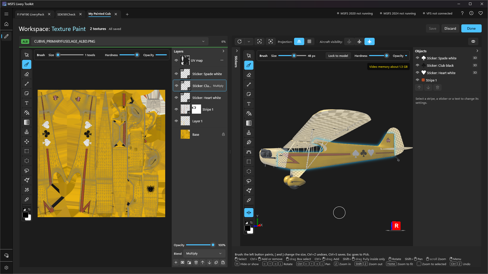

1. TOC
{:toc}

---

## Entering and leaving

Select a texture in the [Workspace]({{ '/workspace.html' | relative_url }}) tree and choose **Paint texture**, either at the top of the page beside Compile or in the texture's Actions. Select several textures and it reads **Paint 3 textures**, for example. Right-clicking a texture or the Textures folder also offers **Paint all textures**, and right-clicking the aircraft in the viewport offers the texture under the pointer.

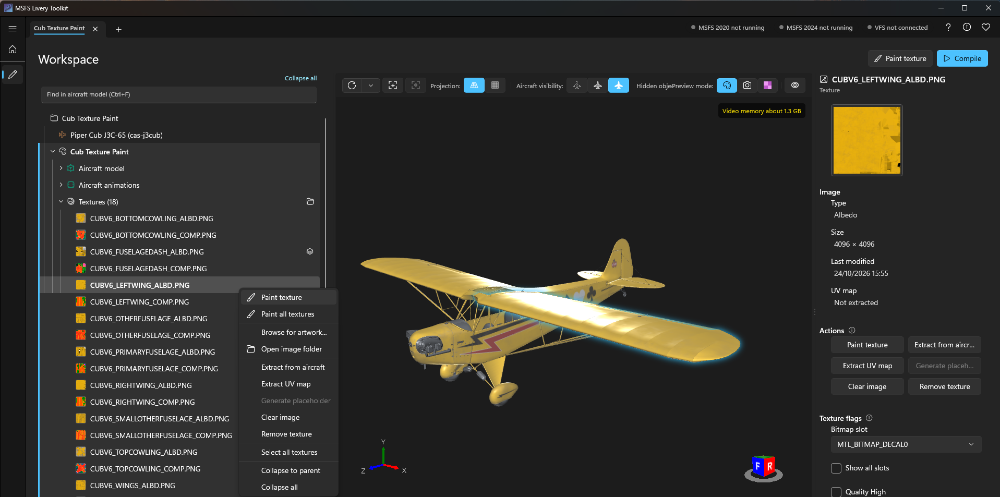

The Workspace changes to Texture Paint:

- The tree and the properties panel fold away. The **2D panel** takes their place on the left, and the **aircraft** stays in 3D on the right. You can paint in either one, and both show every stroke as you make it.
- The page header reads **Workspace: Texture Paint**, with how many textures are open, whether there are unsaved changes, and **Save**, **Discard** and **Done**. The box above the 2D panel names the texture you are painting and switches to another. A dot marks a texture you have painted since you started.
- **Compile**, switching livery and closing the project are locked until you leave. If you try, the app asks whether to save.

**Ctrl+S** saves and stays in the mode. **Done** saves and leaves. **Discard** leaves and throws away everything since your last save, after asking. **Esc** steps back one level at a time: back to the Pick tool, then the selection clears, then it offers to leave.

Only the textures you chose are painted; the rest of the aircraft is masked, so a stroke never strays onto them. A texture can be painted when:

- **It is an albedo or composite texture.** Normal maps can't be painted.
- **It has an image.** Choose Generate placeholder or Extract from aircraft first.
- **The aircraft is shown in the viewport.** Load the aircraft model first. Aircraft protected by the simulator have no 3D view, so they can't be painted.

---

## Where your paint is kept

Painting never changes your original image. The app keeps your paint separate and combines the two when it needs the finished texture.

- **Your original image.** The texture's PNG stays exactly as it was. It opens in Texture Paint as a locked **Base** layer, and everything you paint goes on layers above it.
- **The paint file.** Layers, masks and groups are stored in `Paint\<texture name>.ltpaint`, inside the livery's workspace folder. It holds your paint only, not a copy of the base.
- **The combined texture.** Each save also writes the base and your paint together as one image, `Paint\baked\<texture name>.PNG`, with the same name as your original. The 3D view, the thumbnails and the compile use this one, so your paint reaches the compiled livery while the original stays as it is. It is 8-bit, even when the original is 16-bit.
- **Backups.** The first time you save a texture in a session, its previous paint file is copied to `Paint\backups`, and the last two are kept.

The paint file belongs to the toolkit. To keep painting in Photoshop or another editor instead, link the texture to that file as described in [Creating liveries]({{ '/creating-liveries.html' | relative_url }}#linking-to-artwork-made-in-another-program).

---

## The two views

Each view has its own toolbar down its left edge and its own **options bar** along its top. The options bar shows the settings of the tool selected in that view, and each view keeps its own tool, so you can have the brush in 3D and a selection tool in 2D at the same time. A tool key chooses the tool in the view the pointer is over.

**In the 2D panel**: the wheel zooms about the pointer, a middle-button drag pans, **Home** fits the texture and **1** shows it at 100%. In 3D, **Alt+click** a part to show its texture in the 2D panel.

**In 3D**: the view moves as in the [Workspace]({{ '/workspace.html' | relative_url }}#mouse-and-keyboard). The brush paints onto whatever the pointer is over, so one stroke can carry on across every texture you are painting.

Each tool shows its own pointer: a crosshair with a small badge for the tool. The selection tools' pointers show Add, Subtract or Intersect while you hold **Shift**, **Alt** or both.

### Colours

The colour pair sits at the bottom of each toolbar. The **foreground** colour is what paints, and the **background** colour is the second one, ready to swap in. **X** swaps them and **D** resets them to black and white; the two small buttons above the pair do the same.

Select either swatch to open the colour picker. It has a colour wheel, RGB and hex values, your **Recent colours**, and **Favourites**: **Add** saves the colour shown, and right-clicking a favourite removes it.

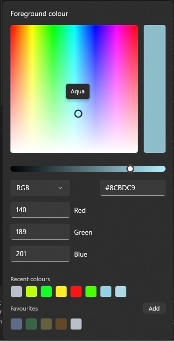

On a composite texture or a layer mask, the pair becomes a pair of greys, and the picker shows a grey slider, a percentage and a row of fixed steps instead.

### Mirror, Paint through and Lock to model

Three settings shape how a stroke lands in 3D:

- **Mirror (Y)**, at the bottom of the 3D toolbar, also paints the mirror image on the other side of the aircraft's centreline. The brush, eraser, line, fill, gradient and selections follow it, and a new stripe starts mirrored. Stickers and text have their own Mirror setting.
- **Paint through**, in the options bar of the brush, eraser, line and gradient, decides which surfaces a 3D stroke reaches:
  - **Off** paints only what you can see.
  - **To centre plane (YZ)** also paints the hidden surfaces, but only on the side of the aircraft where the stroke starts. It stops at the centre plane, X = 0.
  - **All** paints everything under the brush, on both sides. Mirror isn't needed with All.

  Paint through is much slower than painting what you can see, so leave it **Off** unless you need it.
- **Lock to model**, beside the brush size, sets the brush to a real size on the aircraft in millimetres, so it paints the same width at any zoom. Off, the brush stays the same size on the screen.

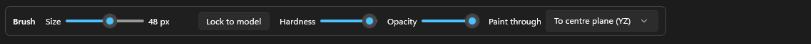

---

## Tools

Hover a tool for its name, its key and what its modifiers do. Most tools are in both views with the same key.

| Tool | Key | Views |
|---|---|---|
| [Pick](#pick) | Esc | 2D and 3D |
| [Brush](#brush-and-eraser) | B | 2D and 3D |
| [Eraser](#brush-and-eraser) | E | 2D and 3D |
| [Line](#line) | U | 2D and 3D |
| [Sticker](#stickers) | K | 2D and 3D |
| [Text](#text) | T | 2D and 3D |
| [Fill](#fill) | G | 2D and 3D |
| [Gradient](#gradient) | Shift+G | 2D and 3D |
| [Clone stamp](#clone-stamp) | S | 2D and 3D |
| [Move](#move) | V | 2D |
| [Pen](#stripes) | P | 3D |
| [Edit stripes](#stripes) | A | 3D |
| [Rectangle select](#selections) | M | 2D and 3D |
| [Ellipse select](#selections) | Shift+M | 2D and 3D |
| [Lasso](#selections) | L | 2D and 3D |
| [Polygon lasso](#selections) | Shift+L | 2D and 3D |
| [Magic wand](#selections) | W | 2D |
| [Eyedropper](#eyedropper) | I | 2D and 3D |

### Pick

In 3D, Pick selects a part and shows its texture in the 2D panel. It also selects stickers and text, which you can then drag to move. In 2D, Pick selects a sticker or text, and drags one placed in 2D. **Delete** removes the selected sticker or text, and **Ctrl+J** duplicates it.

### Brush and eraser

The brush paints the foreground colour onto the selected layer, and the eraser takes paint away from it. Hold **Shift** to keep a stroke level or straight up in 3D, or horizontal or vertical in 2D.

| Option | What it does |
|---|---|
| **Size** | In 2D, the brush size in texture pixels. In 3D, its size on the screen, or on the aircraft with **Lock to model** on. Each view keeps its own size. **[** and **]** change it with the pointer over that view. |
| **Lock to model** | 3D only. See [Mirror, Paint through and Lock to model](#mirror-paint-through-and-lock-to-model). |
| **Hardness** | How much of the brush paints at full strength before it fades. 100 is a hard edge. |
| **Opacity** | The most one stroke paints. Going over the same spot in one stroke never paints past it; let go and paint again to build it up. |
| **Paint through** | 3D only: **Off**, **To centre plane (YZ)** or **All**. |

### Line

Drag a straight line and it is painted when you let go, with the brush's size, hardness, opacity and Paint through. Hold **Shift** to keep it level or straight up, and press **Esc** to cancel it before you let go.

### Fill

Click a part of the texture, a UV island, to fill it with the foreground colour. In 2D, a click where there is no island fills the selection, or the whole image. In 3D, click the island on the aircraft. **Shift+Backspace** fills the selection, or the whole image, from either view.

| Option | What it does |
|---|---|
| **Opacity** | How strongly the fill paints. |
| **Bleed** | How many texels, 0 to 8, the fill spreads past an island's edge, so its seams don't show as thin lines in the simulator. 0 stops at the edge. |
| **Ignore UV map** | Fills the selection, or the whole image or mask, instead of the island under the pointer. In 3D, a click fills the whole selection on every texture it covers in one go. It turns itself on when you start painting a layer mask with the UV map hidden. |

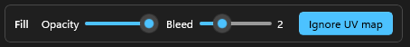

### Gradient

Drag from where the gradient starts to where it ends, and it is painted when you let go. Hold **Shift** to keep the angle to steps of 45 degrees, and press **Esc** to cancel.

The gradient fills the UV island where the drag starts, as Fill does. In 2D, a drag started where there is no island fills the selection, or the whole image. In 3D, a drag started off the aircraft fills the 3D selection, or the island where it ends. With **Ignore UV map** on, it fills the whole selection, or with nothing selected, all of the livery in view.

| Option | What it does |
|---|---|
| **Gradient** | The swatch opens the gradient editor. See below. |
| **Linear** or **Radial** | Linear runs along the drag. Radial spreads out from where the drag starts. |
| **Opacity**, **Bleed**, **Ignore UV map** | As for [Fill](#fill). |
| **Paint through** | 3D only, with Ignore UV map on and nothing selected: **Off**, **To centre plane (YZ)** or **All**. |

The **gradient editor** starts from the foreground and background colours.

- **Stops**: click under the bar to add a stop, drag a stop to move it, or drag it down to remove it. **Location (%)** places the selected stop exactly, and **Remove stop** removes it.
- **Colour**: each stop has its own colour and opacity, set in the picker below, so a gradient can fade to clear.
- **Reverse** runs the gradient the other way.
- **Presets**: **Save** keeps the gradient as a preset. Click a preset to use it, and right-click it to remove it.

On a composite texture or a layer mask, every stop is a grey with its own opacity.

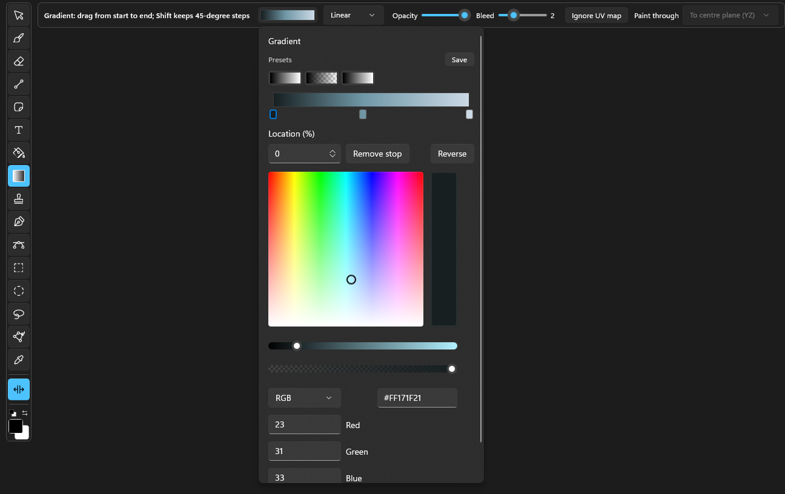

### Clone stamp

**Alt+click** to set the source, then paint to copy from it. It uses the brush's size, hardness and opacity, and **Shift** keeps a stroke straight as with the brush. In 3D the source can be on another texture than the one you paint.

| Option | What it does |
|---|---|
| **Aligned** | On, each stroke carries on the same copy. Off, each stroke starts again from the source. |
| **Sample** | 2D only: copy what shows from **All layers**, or only the **Current layer**. The 3D clone always copies all layers. |

### Move

In the 2D panel, Move drags the selected layer. The arrow keys nudge it by one pixel, and with **Shift** by 10. Whatever goes past the edge of the texture is cut off when you let go.

### Eyedropper

Click to take the colour under the pointer as the foreground, or **Alt+click** to take it as the background. It reads the texture as all the shown layers make it, unlit, so the 3D view's lighting doesn't change the colour you get.

---

## Selections

Paint only lands inside a selection. The brush, eraser, line, clone stamp, fill and gradient all stay inside it. Stickers, text and stripes aren't affected.

| Tool | Key | How to use it |
|---|---|---|
| Rectangle select | M | Drag a box. |
| Ellipse select | Shift+M | Drag a box. Hold **Shift** for a circle. |
| Lasso | L | Hold and draw. Letting go closes the shape. |
| Polygon lasso | Shift+L | Click each corner. A double-click, **Enter** or the first corner closes it. |
| Magic wand | W | 2D only. Click to select pixels of a similar colour. |

Every selection tool has these options:

| Option | What it does |
|---|---|
| **New** | A new shape replaces the selection. |
| **Add** | A new shape adds to the selection. Or hold **Shift** for one shape. |
| **Subtract** | A new shape takes away from the selection. Or hold **Alt**. |
| **Intersect** | Only what is in both the selection and the new shape stays selected. Or hold **Shift+Alt**. |
| **Anti-alias** | Smooths the selection's edge. Clear it for a hard, pixel-exact edge. One setting for every selection tool in both views. |

The **magic wand** also has **Tolerance**, how far each colour channel may be from the colour you click, from 0 to 255, and **Contiguous**: on, only pixels joined to the one you click; cleared, every pixel of that colour on the texture.

**Ctrl+D** clears the selection and **Ctrl+Shift+I** inverts it, in the view the pointer is over. In 3D, Ctrl+D clears every selection.

### Selecting in 3D

In 3D a selection is a shape on the screen, and only the surface inside it takes paint. It stays on the screen, so it no longer lines up with the aircraft once you move the camera.

Turn on **Wrap on model** to wrap each shape onto the aircraft instead. The selection then stays on the surface as you turn the camera, and the 2D panel shows the same selection. The view switches to orthographic while Wrap on model is on. Add and subtract shapes from different angles to build up the area you want. Outside the selection the aircraft shows a red and dark checker, with a dashed line along the edge.

**Select through**, beside Wrap on model, decides which surfaces a shape reaches:

- **Off** selects only what you can see.
- **To centre plane (YZ)** also selects hidden surfaces, on the side each point of the shape first meets, up to the centre plane.
- **All** selects everything under the shape, on both sides, such as both sides of a fin.

With **Mirror** on, the other side of the aircraft is selected too.

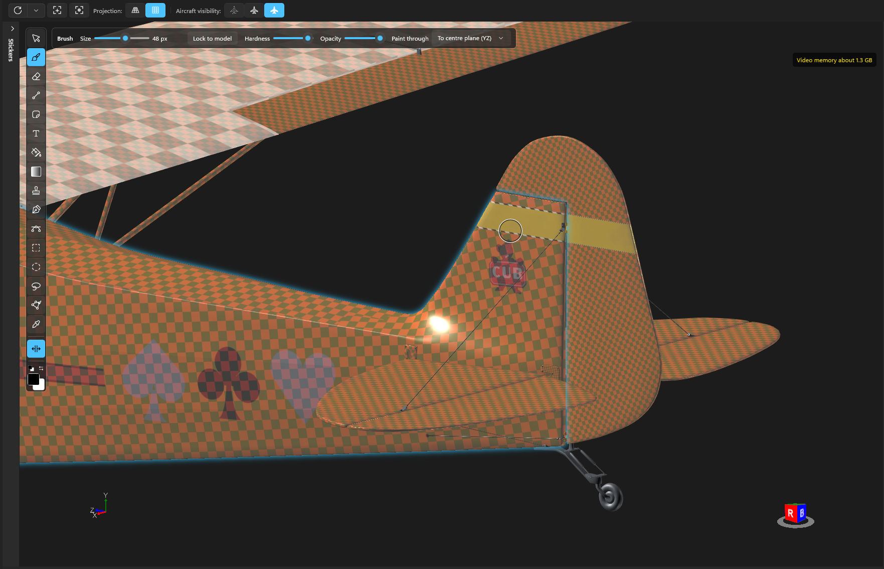

A selection on a texture, made in either view, keeps painting inside it in both views. While a wrapped selection exists, parts it doesn't reach take no paint.

---

## Layers, masks and groups

The **Layers strip** is the column on the right of the 2D panel. Below the list are the selected layer's **Opacity** and **Blend** mode, then buttons to add a layer, add a mask, add a group, delete, move up, move down, copy and paste.

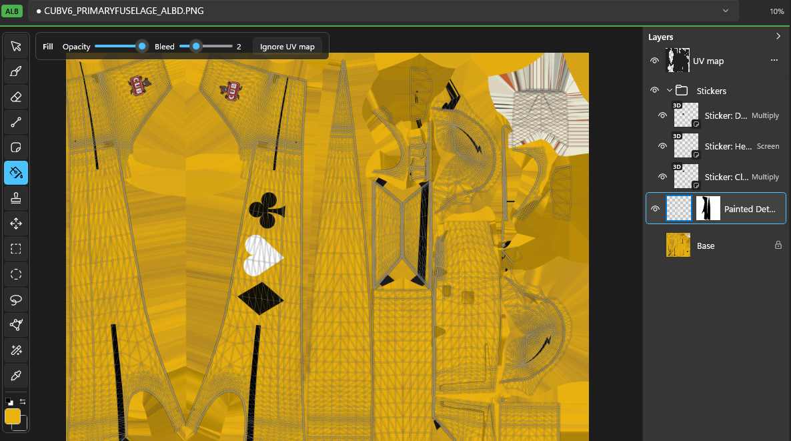

- **Layers.** Add, delete, show and hide them, and give each its own opacity and blend mode: **Normal**, **Multiply**, **Screen** or **Overlay**. Click a layer's thumbnail to paint on it. Copy a layer's pixels with **Ctrl+C** and paste an image as a new layer with **Ctrl+V**. **Drag** a row to reorder it, or use the up and down buttons. Right-click a layer for **Add mask**, **Add hide-all mask**, **Add mask from selection** and **Add to new group**.
- **Masks.** A mask hides part of a layer without erasing anything. Paint white to show and black to hide. **Alt+click** the mask button to start with the whole layer hidden. Click a mask's thumbnail to paint on the mask; a **MASK** badge shows above the 2D panel while you do. **Shift+click** it to turn the mask off or on, **Alt+click** it to see the mask on its own, and **Ctrl+click** it to turn the mask into a selection (**Shift** adds, **Alt** subtracts, both intersect). **Ctrl+I** inverts the mask. Right-click a mask for **Invert mask**, **Apply mask** and **Delete mask**.
- **Groups.** Put layers in a group to move, hide or mask them together. **Ctrl+G** puts the selected layer in a new group and **Ctrl+Shift+G** ungroups it, or drag layers into a group. A mask on a group applies to everything inside it. A new group's blend mode is **Pass through**, so its layers mix with what is below as if they weren't grouped. Right-click a group for **Ungroup**, **Delete group** (its layers stay) and **Delete group and contents**.
- **UV map.** The first row of the strip is the texture's UV layout, shown as a guide over the texture. It is never painted, saved or compiled. Its eye shows or hides it, and its options set its **Opacity** and a **Dark outline, for light textures**.

Click the arrow at the top of the strip to fold it to a narrow bar, and click the bar's name to open it again.

Every stroke, move and layer change is one **Ctrl+Z** step.

---

## The Objects strip

The **Objects strip**, on the right of the 3D view, lists every stripe, sticker and text. Select one to edit its settings below the list. Each setting has an **i** beside it that explains it.

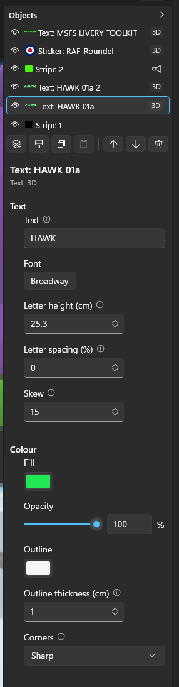

- The buttons under the list hold the selected object's own actions, then **Up**, **Down** and **Delete**. Up and Down move the object over or under its neighbour in every texture they share. You can also drag a row.
- Right-click a row for **Rename**, **Duplicate** (**Ctrl+J**), **Rasterize** and **Delete**, and for text, **Copy style** and **Paste style**. **Rasterize** turns the object into ordinary layers you can paint on, and it can no longer be edited as an object.
- An eye on a stripe's row hides or shows it.
- **Apply to** lists the textures the object paints. Clear one to stop the object at that texture's edge. A texture the object reaches that you aren't painting yet has **Add to painting**.

Every object can also have a **Finish**: see [Finish](#finish).

---

## Stripes

The **Pen** draws a stripe onto the aircraft as a curve, which is how cheatlines and tail stripes are normally painted. A stripe stays editable, and it is drawn across every texture it crosses.

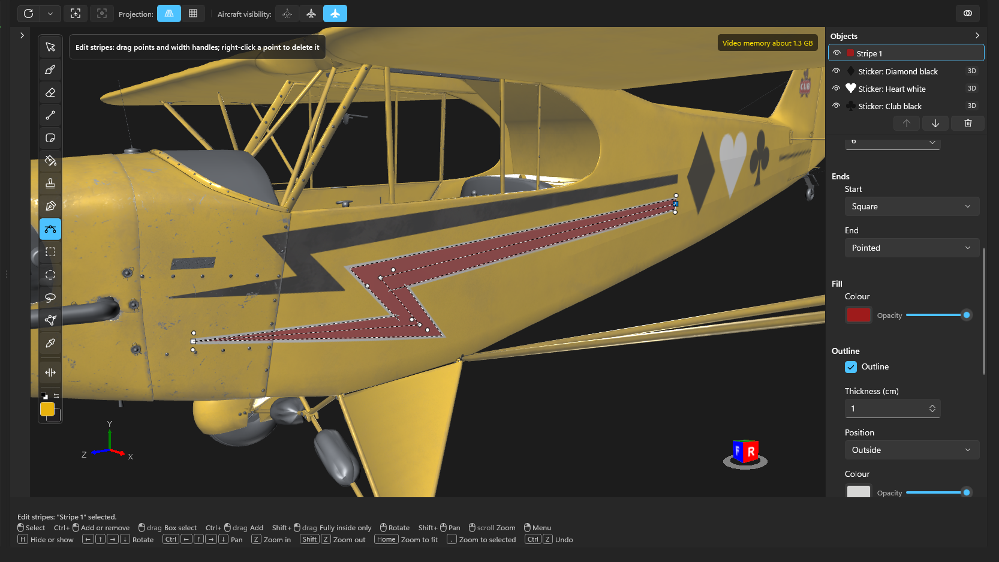

1. Choose the **Pen** (**P**) and click points along the aircraft. **Alt+click** makes a sharp corner. **Shift** keeps a point level or straight up from the last.
2. Press **Enter**, double-click, or click the first point to finish. The stripe is filled with the foreground colour.
3. Switch to **Edit stripes** (**A**) and click a stripe to select it. Drag its points, and drag its width handles so the stripe tapers along its length. Click the curve to add a point, **Alt+click** a point to make it sharp or smooth again, **Shift** while dragging keeps a point level or straight up, and right-click a point to delete it.

The Pen's options are for the next stripe:

| Option | What it does |
|---|---|
| **Width (cm)** | The width of a new stripe on the aircraft. Change it afterwards in the stripe's settings or with Edit stripes. |
| **Projection** | **Wrap** places the points on the surface, and the stripe follows it. **Project** places them on a flat plane facing the view and projects the stripe straight onto the aircraft, so it can run off the end of a part. |
| **Paint through** | With Project only: **Off**, **To centre plane (YZ)** or **All**, for the next projected stripe. Each stripe keeps its own. |

### Projected stripes

With Projection set to **Project**, the view turns orthographic and its angle is locked while you draw: a coloured frame goes round the view, with a **Drawing a projected stripe** bar and **Done**. Choose your angle before the first point; for a side stripe, look straight at the side of the aircraft.

To change a projected stripe later, double-click it, or select it and choose **Align view and edit** in its settings. The view turns to face the way the stripe is projected and locks while you edit; **Done** or **Esc** unlocks it. **Align projection to view** instead projects the stripe from the current view, keeping its shape as you see it now.

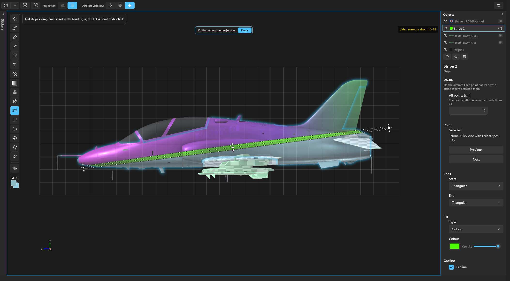

### A stripe's settings

Select a stripe in the Objects strip, or with Edit stripes, to see its settings.

| Section | Settings |
|---|---|
| **Width** | **All points (cm)** sets the width of every point at once. It is blank when the points differ. |
| **Point** | The selected point, with **Previous** and **Next** to step through them, its own **Width (cm)**, and **Sharp corner** for a point between two others. |
| **Ends** | **Start** and **End**: **Square**, **Round**, **Pointed** (a true taper), **Triangular** or **Forked** (a V notch). New stripes start with the ends of the last one. |
| **Fill** | **Type**: **Colour**, with its colour and opacity, or **Gradient**, with a gradient editor as the [Gradient tool's](#gradient) and **Direction**: **Along** runs from start to end, **Across** from edge to edge. |
| **Outline** | Switch it on for an outline, with its **Thickness (cm)**, **Position** (**Inside**, **Centre** or **Outside** the stripe's edge) and **Colour**. |
| **Finish** | See [Finish](#finish). |
| **Mirror** | **Mirrored** also paints the mirror image across the centreline. **Mirror tolerance (cm)** is how far a mirrored point may move to land on the aircraft. Not needed with Paint through set to All. |
| **Projection** | Projected stripes only: **Paint through**, **Align projection to view** and **Align view and edit**. |
| **Apply to** | The textures the stripe paints. |

---

## Text

The **Text** tool (**T**) places a line of lettering, such as a name or a registration, on the aircraft in 3D or flat on the texture in 2D. Type the text in the options bar, then click to place it. The text stays editable afterwards.

For a registration number the simulator sets for each aircraft, use [Registration numbers]({{ '/creating-liveries.html' | relative_url }}#registration-numbers) instead.

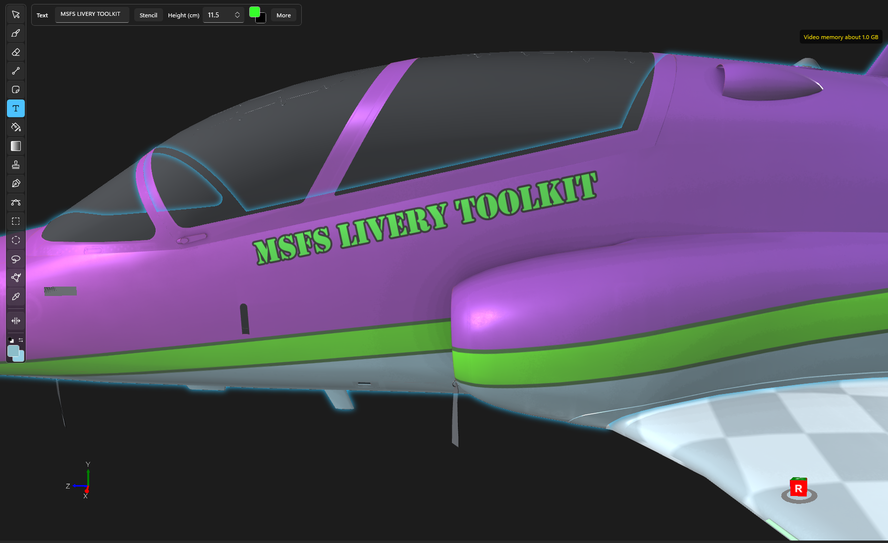

| Option | What it does |
|---|---|
| **Text box** | The text to place, on one line. |
| **Font** | Opens the font settings: **Font**, any font installed in Windows; **Style**, the font's own styles such as Bold or Italic; **Letter spacing (%)**, extra space after each letter as a percentage of the letter height (below 0 brings the letters closer); **Skew (degrees)**, which leans the letters, for a font with no italic; and the outline's **Thickness** and **Corners**, Round or Sharp. |
| **Height** | The height of a capital letter: in centimetres on the aircraft in 3D, or in pixels on the texture in 2D. |
| **Fill and outline colours** | The two swatches: the letters' colour over the outline's colour. The outline only shows when its thickness is above 0. |
| **More** | **Rotation (degrees)**, clockwise; **Flip H** and **Flip V**, which flip the letters for a part whose texture is mirrored; and in 3D, **Projection**: **Surface** lays the text along the surface under the pointer, the same from any angle, and **View** projects it along your line of sight, so it stretches on a slanted surface. |

Before you click, **Ctrl+wheel** or **[** and **]** change the height, **Shift+wheel** turns the text by 15 degrees and **Ctrl+Shift+wheel** by 1 degree.

To change a text later, select it with Pick or in the Objects strip. Its settings have the same values, plus **Opacity**. You can move it with Pick, size it with Ctrl+wheel, and turn it with Shift+wheel.

- **Copy style** and **Paste style** give another text the same font, spacing, skew, colours, outline and opacity.
- **Format painter** does the same in one step: select it, then click the text to change in the Objects list.
- **Duplicate** (**Ctrl+J**) makes a copy just below it.

If a text's font is no longer installed, only its font can be changed until you choose one that is.

---

## Stickers

Stickers place a logo, badge or lettering image on the aircraft in 3D, or on the flat texture in 2D.

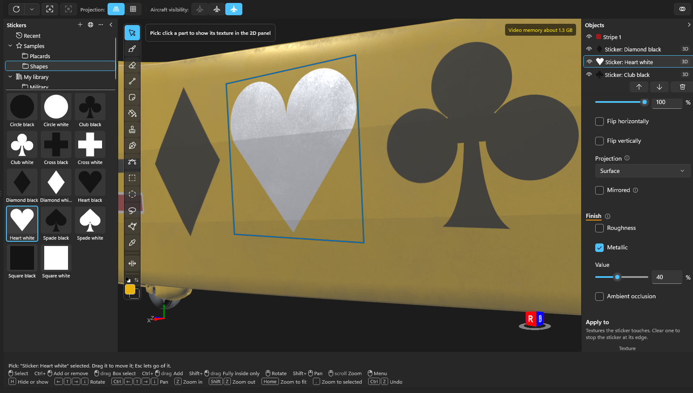

The **sticker library** is a pane at the left edge of the viewport. A folder tree lists **Recent**, **Samples** (plain shapes and placards that come with the app) and **My library**, with the images of the selected folder below. The buttons at the top add images, add from a link, and open more options, and the arrow folds the pane to a narrow bar. The app ships no national markings or insignia.

- **Add images** with **Add images...**, **Paste image**, or **Add from URL...**, which takes a link to an image or an SVG and a name. A Wikimedia file page link works too. **New folder** and **Add folder...** organise the library; Add folder shows a folder from anywhere on your PC without moving it.
- **Place** one by choosing it, then clicking with the **Sticker** tool (**K**), or by dragging its tile onto the aircraft or the texture.

The Sticker tool's options are for the next sticker:

| Option | What it does |
|---|---|
| **Image** | The image chosen in the library. |
| **Width** | In metres on the aircraft in 3D, or in pixels on the texture in 2D. The height follows the image. **Ctrl+wheel**, **[** and **]** change it. |
| **Rotation** | Degrees, clockwise. **Shift+wheel** turns it 15 degrees, **Ctrl+Shift+wheel** 1 degree. |
| **Flip H**, **Flip V** | Flip the image horizontally or vertically. |
| **Opacity** | How strongly the sticker paints. |
| **Mirror** | 3D only. Also places a true reflection on the other side of the aircraft. The image reads backwards there, so leave it off for lettering. |
| **Projection** | 3D only. **Surface** lays the image along the surface under the pointer, the same from any angle. **View** projects it along your line of sight, so it stretches on a slanted surface. |

To change a placed sticker, select it with Pick or in the Objects strip. You can drag it with Pick, and its settings have the same values plus **Replace from library**, which puts the image selected in the library in its place. A sticker follows its part if the model changes.

By default the library is the folder `Documents\MSFS Livery Toolkit\Stickers`. It is an ordinary folder, so you can add, rename and share images in Explorer. Change its location in [Settings]({{ '/configuration.html' | relative_url }}#sticker-library). Only images you add are stored there; Add from URL is the one place Texture Paint uses the network, and only when you ask. See [Trust & safety]({{ '/trust-and-safety.html' | relative_url }}#does-it-phone-home).

---

## Finish

A stripe, sticker or text can also paint into the aircraft's **composite textures** under it, so it can be shinier, rougher or more metallic than the paint around it. The **Finish** section of its settings has a switch for each of **Roughness**, **Metallic** and **Ambient occlusion**. Select one to set its value; a stripe with an outline has one value for the fill and one for the outline. A cleared channel is left as the aircraft has it.

Each channel also has a **Blend**: how much of the value replaces what the composite texture holds there. 100% replaces it; lower mixes it with the aircraft's own finish.

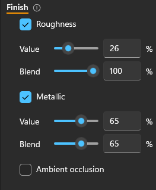

Finish only reaches composite textures that are already in your livery. **Apply to** lists any the object reaches that aren't. To add one, leave Texture Paint, add it with Add textures and extract it from the aircraft; the object paints it the next time you start Texture Paint.

---

## Composite textures

A composite texture packs roughness, metalness and ambient occlusion into one image, one per colour channel. In Texture Paint you paint them as three separate grey images instead.

- Use the **channel switch** above the 2D panel to choose **Roughness**, **Metallic** or **Ambient occlusion**. White is full roughness, metal or light, and black is none. The colour pair becomes a pair of greys.
- Turn on **Preview** to show the channel in grey on the aircraft, unlit.
- The Layers strip's **Extract from aircraft** button pulls the aircraft's own values for the channel in as a new layer to work from.
- Only composites already added to your livery can be painted.

Choosing an albedo texture to paint brings its livery composite into the session too, when they belong to the same material, and the other way round. Each is still painted on its own.

---

## Keyboard shortcuts

A tool key works in the view the pointer is over, or was last over.

| Keys | Action |
|---|---|
| Ctrl+S | Save |
| Ctrl+Z | Undo |
| Esc | Back to Pick, then clear the selection, then leave |
| B, E, U, G, Shift+G, S, I | Brush, Eraser, Line, Fill, Gradient, Clone stamp, Eyedropper |
| K, T | Sticker, Text |
| M, Shift+M, L, Shift+L, W | Rectangle, Ellipse, Lasso, Polygon lasso, Magic wand (2D) |
| V | Move (2D) |
| P, A | Pen, Edit stripes (3D) |
| [ and ] | Smaller and larger brush, sticker or text |
| X, D | Swap colours, black and white |
| Y | Mirror on or off |
| Ctrl+D, Ctrl+Shift+I | Clear the selection, invert it |
| Shift+Backspace | Fill the selection, or the whole image |
| Ctrl+C, Ctrl+V | Copy the layer's pixels, paste an image as a layer |
| Ctrl+G, Ctrl+Shift+G | Group, ungroup |
| Ctrl+I | Invert the selected mask |
| Ctrl+J | Duplicate the selected sticker or text |
| Delete | Delete the selected sticker or text (with Pick) |
| Home, 1 | 2D: fit the texture, show it at 100% |

---

## Tips

- Save often with **Ctrl+S**. The first save of each session keeps a backup of your previous paint file.
- Work from a selection or a mask when you need a clean edge. They are quicker to correct than a stroke.
- Leave **Paint through** on **Off** unless you mean it. On a big texture it is much slower than painting what you can see.
- Use **Lock to model** in 3D so a stroke is the same width however close you are.
- For a stripe that should run straight off the end of a part, such as across a tail, draw it with **Project**.
- When you are happy, leave with **Done**, then [compile]({{ '/compiling.html' | relative_url }}) as usual. The compile uses the combined texture, so your original PNG is left untouched.

## What isn't there yet

- Painting isn't available for aircraft the simulator protects.
- One brush stroke doesn't paint albedo and composite channels together. Switch channels to paint each.
- Painting with Paint through set to To centre plane or All is slow.
- No layer styles (such as colour overlay), guides or rulers, and you can't select several layers at once.
- Moving a linked layer up or down in a document with groups doesn't restack it in the aircraft's other textures.
